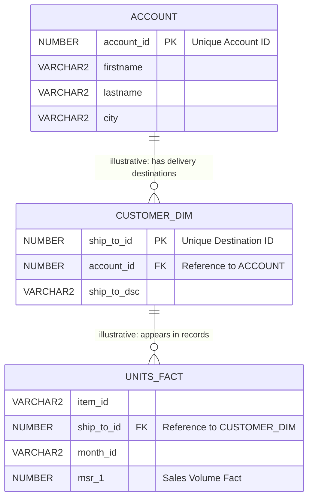
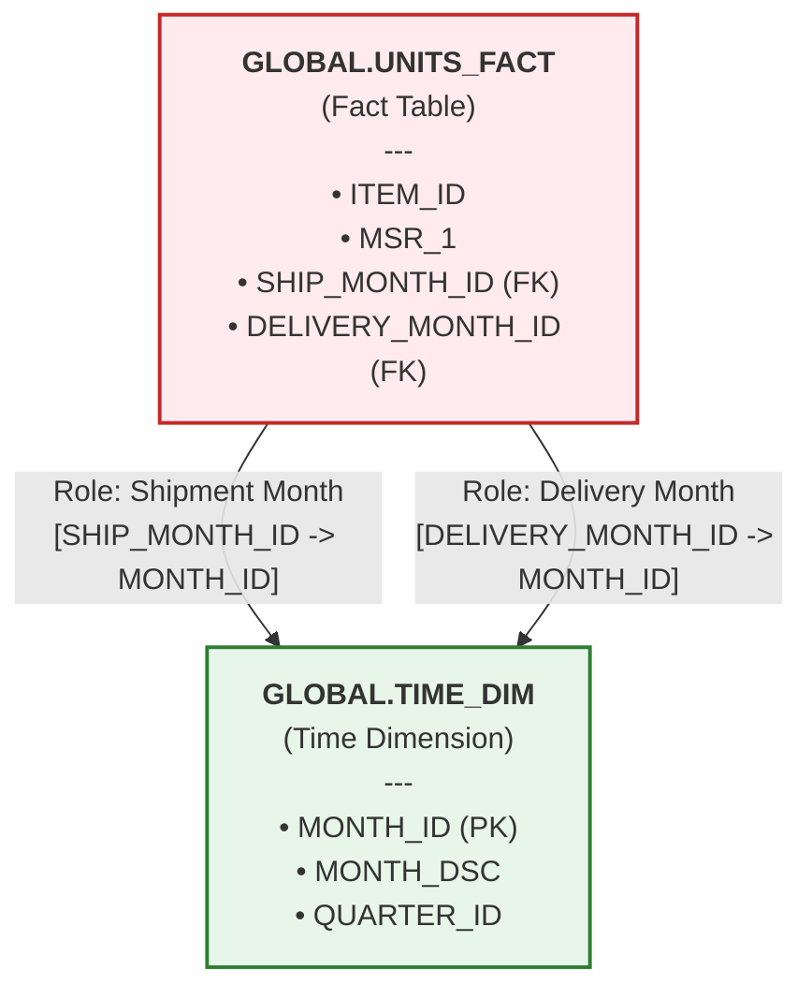
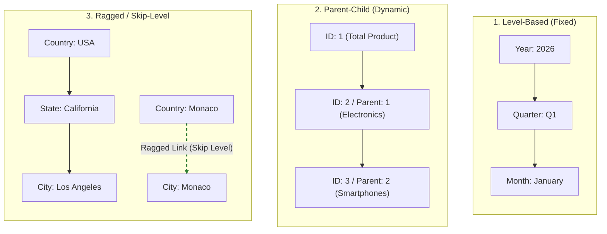

# GLOBAL11 Multidimensional OLAP Metadata Documentation

This document describes the architecture, relational source structures, and OLAP design work for the real **Global11** data platform, historically deployed and operated on an office server with Oracle Global 11g. The relational platform is real; the multidimensional artefacts below are documented design patterns and are kept distinct from deployed OLAP objects.

---

## 1. Project Description & Architecture Overview

The Global11 project covers data-engineering workflows for transforming transactional data into analytical structures. The architecture bridges the gap between highly normalized relational storage and high-performance Online Analytical Processing (OLAP) systems.

### Core Architectural Layers

1. **Relational Source Layer (`GLOBAL` Schema):** Standard relational tables containing transactional facts (`UNITS_FACT`) and historical operational records (`ACCOUNT`, `CUSTOMER_DIM`).
2. **Dimensional Modeling Layer:** **Design of analytical dimensions** featuring strict levels, parent-child hierarchies, and role-playing time constraints to capture complex business logic.
3. **Multidimensional Aggregation Layer:** Logical cube (`CUBE_1111`) for target aggregation patterns and analytical calculations.

---

## 2. Relational Schema Changes Documented for the Project

The DDL statements describe schema changes associated with the Global11 project. The platform itself was deployed and operated on an office server. The current state of the historical database was not queried again during preparation of this portfolio documentation.

```sql
-- 1. Intended modifications to the transactional fact table to support role-playing dimensions
ALTER TABLE global.units_fact ADD SHIP_MONTH_ID varchar2(7);
ALTER TABLE global.units_fact ADD DELIVERY_MONTH_ID varchar2(7);

-- The project change set initializes both role keys from MONTH_ID.
-- They therefore contain identical baseline values; this does not reconstruct
-- independently sourced shipment and delivery event dates.
UPDATE global.units_fact SET SHIP_MONTH_ID = MONTH_ID;
UPDATE global.units_fact SET DELIVERY_MONTH_ID = MONTH_ID;

-- 2. Creating a physical consolidation table for customer and account metadata
CREATE TABLE GLOBAL.cust_account AS
SELECT
    GLOBAL.CUSTOMER_DIM.SHIP_TO_ID,
    GLOBAL.CUSTOMER_DIM.SHIP_TO_DSC,
    GLOBAL.CUSTOMER_DIM.SHIP_TO_DSC_FRENCH,
    GLOBAL.CUSTOMER_DIM.SHIP_TO_DSC_DUTCH,
    GLOBAL.ACCOUNT.ACCOUNT_ID,
    GLOBAL.ACCOUNT.FIRSTNAME,
    GLOBAL.ACCOUNT.LASTNAME,
    GLOBAL.ACCOUNT.ADDRESS,
    GLOBAL.ACCOUNT.ADDRESS2,
    GLOBAL.ACCOUNT.CITY,
    GLOBAL.ACCOUNT.STATE_PROV,
    GLOBAL.ACCOUNT.COUNTRY,
    GLOBAL.ACCOUNT.ZIP_PC,
    GLOBAL.ACCOUNT.PHONE,
    GLOBAL.ACCOUNT.FAX,
    GLOBAL.ACCOUNT.EMAIL
FROM
    GLOBAL.CUSTOMER_DIM
INNER JOIN
    GLOBAL.ACCOUNT ON GLOBAL.CUSTOMER_DIM.ACCOUNT_ID = GLOBAL.ACCOUNT.ACCOUNT_ID;
```

---

## 3. Data Model Visualization

The operational and analytical layout incorporates three complementary diagrams detailing the entity relationships, role-playing mechanics, and OLAP navigation strategies.

### Entity Relationship Diagram (Relational Blueprint)

The diagram summarizes logical relationships in the project data model. Physical constraints and cardinalities should be interpreted from the corresponding source DDL or database metadata where available.



### Role-Playing Time Dimension

The transactional fact table maps the single physical time dimension into two distinct operational contexts: `Shipment Month` and `Delivery Month`. This is a target modeling pattern; the illustrative baseline updates above populate both role keys with the same source month and therefore do not demonstrate separate business event dates.



### OLAP Hierarchy Patterns

The architecture maps diverse dimensional configurations to resolve specific source data traits:

- **Level-Based:** Fixed hierarchical levels, such as Year, Quarter, and Month.
- **Parent-Child:** Dynamically nested structures based on parent and child identifiers.
- **Ragged / Skip-Level:** Hierarchies in which intermediate levels may be absent.



These diagrams help explain how relational source structures support multidimensional analytical models.

---

## 4. Oracle OLAP Conceptual Design Models

> **Technical Status Notice:** The artifacts and XML/SQL code blocks in this section represent conceptual blueprints illustrating the architectural intent. They are target measures and aggregation patterns rather than validated production scripts, and they require validation against a live Oracle OLAP environment.

### A. Conceptual Metadata Schema Blueprint (XML Design Pattern)

The following XML document provides an author-defined abstract schema layout mapping the target multidimensional environment. It outlines the integration parameters of the analytical workspace.

```xml
<?xml version="1.0" encoding="UTF-8"?>
<!-- Conceptual schema layout for architectural visualization only -->
<ConceptualOLAPModel CubeName="CUBE_1111" TargetWorkspace="GLOBAL_AW">
  <Dimensions>
    <Dimension Source="TIME" Type="TimeDimension" />
    <Dimension Source="CUSTOMERS" Type="StandardDimension" />
    <Dimension Source="PRODUCT_VB" Type="ValueBasedDimension" />
  </Dimensions>

  <Measures>
    <TargetMeasure Name="MSR_1" SourceFact="UNITS_FACT.MSR_1" Aggregation="SUM" />
    <TargetMeasure Name="MSR_2" SourceFact="UNITS_FACT.MSR_2" Aggregation="SUM" />
  </Measures>

  <CalculatedMeasures>
    <!-- Target design pattern for evaluating hierarchical positioning -->
    <CalculatedMeasure Name="CALC_MSR1" Type="AnalyticalRank" EvaluatedWithin="CUSTOMERS.SHIP_TO_COUNTRY_HIER">
      <Logic>
        RANK() OVER (HIERARCHY CUSTOMERS.SHIP_TO_COUNTRY_HIER ORDER BY MSR_1 DESC NULLS LAST WITHIN LEVEL)
      </Logic>
    </CalculatedMeasure>
  </CalculatedMeasures>
</ConceptualOLAPModel>
```

### B. High-Level Pre-Computation Flow (PL/SQL Orchestration Pseudocode)

The automated consolidation and solving of data partitions within the analytical server are designed to execute through the database engine. The template below illustrates the theoretical programmatic execution flow using safe execution blocks.

```sql
DECLARE
    -- Placeholder mapping the configuration parameters for the analytical solver
    v_conditional_command VARCHAR2(1000) := 'BUILD GLOBAL.CUBE_1111 USING METHOD COMPLETE';
BEGIN
    -- Architectural Placeholder:
    -- This block presents the intended execution pattern for administrative calls.
    -- Live deployments must map explicit signatures required by the standard DBMS_CUBE package.
    NULL;

    -- Target execution call model:
    -- DBMS_CUBE.BUILD(script => v_conditional_command, parallelism => 2);
END;
/
```

### C. Target Analytical Query Pattern (SQL View Simulation Template)

Once the analytical engine materializes the underlying cubes, the multi-dimensional metrics are projected back as relational abstractions via system views. The template below models how client reporting applications query the calculated dataset. The view names and columns below are placeholders, not asserted Oracle-generated object names.

```sql
-- Target simulation query for analytical reporting applications
SELECT
    c.country_name AS "Country",
    c.parent_region AS "Region",
    f.msr_1 AS "Sales Volume (MSR_1)",
    f.calc_msr1 AS "Intra-Region Rank (CALC_MSR1)"
FROM
    GLOBAL.CUBE_1111_CONCEPTUAL_VIEW f
INNER JOIN
    GLOBAL.CUSTOMERS_CONCEPTUAL_VIEW c ON f.customers = c.dim_key
WHERE
    c.level_name = 'COUNTRY'
    AND f.time = 'YEAR_2026'
ORDER BY
    c.parent_region,
    f.msr_1 DESC;
```

---

## 5. Technical References

The following official Oracle documentation pages provide version-specific reference material for the Oracle Database 11g Release 2 (11.2) context. Product documentation for SQL Developer Data Modeler is listed separately because its release numbering is independent of the database release.

- **DBMS_CUBE Package Reference:** [Oracle Database PL/SQL Packages and Types Reference 11g Release 2 (11.2), Chapter 41 — DBMS_CUBE](https://docs.oracle.com/cd/E18283_01/appdev.112/e16760/d_cube.htm)
- **OLAP Cube Views and Querying:** [Oracle OLAP User's Guide 11g Release 2 (11.2), Chapter 4 — Querying Dimensional Objects](https://docs.oracle.com/cd/E24693_01/olap.11203/e17123/query.htm)
- **Analytical Expressions and RANK:** [Oracle OLAP Expression Syntax Reference 11g Release 2 (11.2) — RANK](https://docs.oracle.com/cd/E24693_01/olap.11203/e23381/olap_functions021.htm)
- **Multidimensional Model Import and Export:** [Oracle SQL Developer Data Modeler FAQ — Import and export capabilities](https://www.oracle.com/tools/technologies/faq-sql-developer-data-modeler.html)

---

## Final Cube_1111 Specification

The consolidated final design summary, submitted DDL, SQL validation query, requirement checklist, and high-level Mermaid diagram are maintained in [the final Cube_1111 specification](model/CUBE-1111-FINAL-SPECIFICATION.md) and [the OLAP diagram source](model/olap-diagram.mmd).

**Documentation Status:** Documentation Complete.  
**Technical Validation:** Pending — execution of the submitted scripts and inspection of the objects in Oracle AW 11gR2 / JDBC `Global_11r21` remain outstanding.

## Validation Status

The document describes the real Global11 relational platform and separates it from the proposed OLAP layer. The XML, PL/SQL, cube, and analytical-query fragments in the OLAP sections are design artefacts; they do not assert that an Analytic Workspace or cube was created. The relational system's historical deployment on an office server is distinct from the implementation status of these OLAP artefacts. Relationship cardinalities, measure additivity, and business event-date mappings must follow the authoritative source model and business rules.
