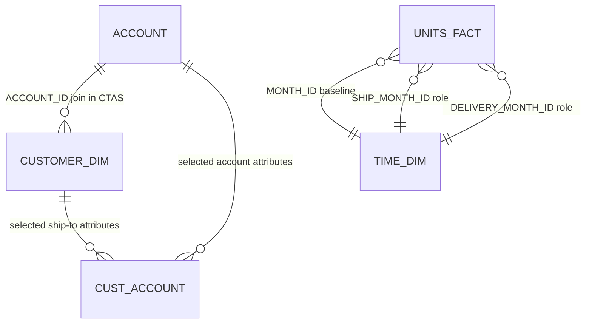

# Global11 Demo — реляционная модель

## 1. Исходные объекты

Согласно README и install package Oracle Global 11g, исходная схема включает следующие таблицы:

| Таблица | Роль в модели |
|---|---|
| `CHANNEL_DIM` | Измерение канала |
| `CUSTOMER_DIM` | Измерение клиента / ship-to |
| `PRODUCT_DIM` | Измерение продукта |
| `TIME_DIM` | Измерение времени |
| `PRICE_FACT` | Факты цен |
| `UNITS_FACT` | Факты объёмов/продаж |
| `ACCOUNT` | Атрибуты аккаунта и контактные данные |
| `PRODUCT_CHILD_PARENT` | Связи parent-child для продукта |

В архиве также присутствуют XML templates для Global, dimensions и cubes. Сам факт наличия template-файла не означает, что соответствующий OLAP-объект развёрнут в базе.

## 2. Подтверждённые связи и изменения проекта

### CUSTOMER_DIM → ACCOUNT

Проектный CTAS соединяет:
`GLOBAL.CUSTOMER_DIM.ACCOUNT_ID = GLOBAL.ACCOUNT.ACCOUNT_ID`.

Это подтверждает использование данного join в формировании `CUST_ACCOUNT`. Полная уникальность и кардинальность связи должны проверяться по данным и ограничениям БД.

### UNITS_FACT → TIME_DIM: две роли времени

В `UNITS_FACT` добавляются:
- `SHIP_MONTH_ID`
- `DELIVERY_MONTH_ID`

Обе колонки имеют тип `VARCHAR2(7)` и первоначально заполняются значением `MONTH_ID`. В целевой аналитической модели это два role-playing reference на временную размерность. В исходных данных, описанных инструкцией, эти роли не различаются по значениям.

## 3. CUST_ACCOUNT: состав атрибутов

| Источник | Столбцы |
|---|---|
| CUSTOMER_DIM | SHIP_TO_ID, SHIP_TO_DSC, SHIP_TO_DSC_FRENCH, SHIP_TO_DSC_DUTCH |
| ACCOUNT | ACCOUNT_ID, FIRSTNAME, LASTNAME, ADDRESS, ADDRESS2, CITY, STATE_PROV, COUNTRY, ZIP_PC, PHONE, FAX, EMAIL |

Создаваемая таблица материализует результат INNER JOIN. Строки без совпадения по `ACCOUNT_ID` в обеих таблицах в CTAS не попадут.

## 4. Схема отношений (концептуально)

Диаграмма иллюстрирует использование ключей и join в проектной документации. Она не является заменой DDL с PK/FK constraints. Фактические cardinalities, nullability, индексы и ограничения должны быть извлечены из установленной БД.

## 5. Границы достоверности

Подтверждено проектной инструкцией:
- два новых столбца и их тип;
- инициализация обоих столбцов из `MONTH_ID`;
- точный список выбранных столбцов для `CUST_ACCOUNT`;
- join по `ACCOUNT_ID`;
- запрет на создание Analytic Workspace.

Не следует считать подтверждённым без проверки:
- уникальность `ACCOUNT.ACCOUNT_ID` и `CUSTOMER_DIM.ACCOUNT_ID`;
- PK/FK constraints и фактические cardinalities;
- независимые даты отгрузки и доставки;
- индексы, grants и физические свойства CTAS-таблицы;
- фактическую конфигурацию OLAP cube в базе.
